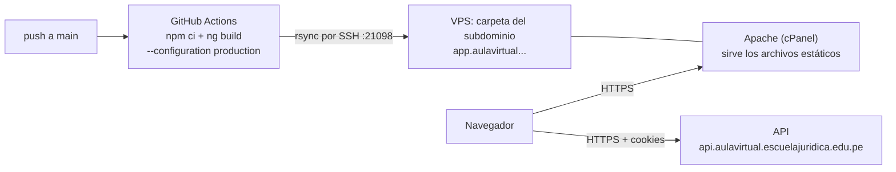

# ESEJUR — Frontend

Aplicación Angular de "Escuela Jurídica" (ESEJUR): catálogo público de cursos, panel de alumno y panel administrativo. Consume la API REST del backend Spring Boot. Proyecto académico del Curso Integrador II — Software (UTP).

## Stack técnico

| Componente | Versión / detalle |
|---|---|
| Angular | 21 (standalone, sin NgModules) |
| Detección de cambios | Zoneless por configuración por defecto (no se incluye `zone.js`; el estado se maneja con `signal`/`computed`) |
| Test runner | Vitest, vía el builder `@angular/build:unit-test` |
| Routing | `provideRouter`, 100% lazy loading con `loadComponent` |
| UI | Componentes propios (sin Material/PrimeNG/Bootstrap); `ngx-spinner` para el loader global; `swiper` para el carrusel del catálogo |
| HTTP | `HttpClient` + interceptores funcionales |
| Gestor de paquetes | npm |

## Estructura de carpetas (`src/app/`)

```
core/
├── api/              URL base de la API + modelo genérico de paginación
├── carga/             Spinner global (contador de peticiones activas)
├── dialogo/            Diálogo de confirmación global (reemplaza confirm() nativo)
├── interceptors/       carga-global, credenciales, sesión vencida
├── layout/             Shells por rol: admin, alumno, auth, público
├── notificaciones/     Alertas globales tipo toast
└── session/             Estado de sesión (signals), guards de ruta

features/
├── admin/              Panel administrativo: cursos, usuarios, matrículas, reportes, info base
├── auth/                Acceso, registro, verificación de correo, recuperación de contraseña
├── cuenta/              Panel del alumno y edición de su propio perfil
├── cursos/              Catálogo público y ficha de curso
├── legal/               Páginas estáticas (privacidad, términos)
└── matriculas/          API/modelo de matrícula compartido entre alumno y admin

shared/ui/
├── alerta-global/           Banner de alerta
├── confirmacion-dialog/     Modal de confirmación, montado una sola vez en la raíz
└── modal/                   Shell de modal genérico
```

## Arquitectura de estado y sesión

**`Session`** (`core/session/session.ts`) mantiene el estado con signals: `_usuario` y `_estado: 'cargando' | 'autenticado' | 'visitante'`. El JWT nunca se guarda en localStorage — vive en una cookie HttpOnly, por eso `credencialesInterceptor` fuerza `withCredentials: true` en toda petición. `restaurar()` se llama una sola vez al arrancar la app (vía `provideAppInitializer`), consulta `GET /auth/sesion` y resuelve el estado antes de que el router empiece a navegar.

**Guards** (`CanActivateFn` funcionales): `sessionGuard` exige sesión autenticada (protege `/app/**`); `adminGuard` exige además rol `ADMINISTRADOR` (protege `/admin/**`).

**Interceptores HTTP** (registrados en `app.config.ts`, en este orden):
1. `cargaGlobalInterceptor` — muestra/oculta el spinner global contando peticiones activas en vuelo.
2. `credencialesInterceptor` — fuerza `withCredentials: true` para que la cookie de sesión viaje entre orígenes.
3. `sesionVencidaInterceptor` — captura cualquier 401 inesperado (excluyendo las rutas `/auth/**`, donde un 401 es normal), limpia la sesión local, redirige a `/acceso` y muestra un diálogo de "sesión finalizada".

**`ConfirmacionService`** reemplaza el `confirm()` nativo: `preguntar(opciones): Promise<boolean>`, resuelta por el único `<app-confirmacion-dialog />` montado en `app.html`, consumible desde cualquier componente. **`AlertaGlobalService`** ofrece un canal de toast simple (éxito/error/info) con auto-cierre a los 5 segundos.

## Routing (`app.routes.ts`)

Un único array, 100% lazy (`loadComponent`), organizado por shells de layout:

| Base | Layout | Guard | Hijos |
|---|---|---|---|
| `''` | `LayoutPublico` | — | catálogo, ficha de curso, privacidad, términos |
| `acceso`, `registro` | sin layout | — | pantalla completa, sin header/footer |
| `''` | `LayoutAuth` | — | verificar correo, recuperar/nueva contraseña |
| `app` | `LayoutAlumno` | `sessionGuard` | panel, perfil |
| `admin` | `LayoutAdmin` | `adminGuard` | usuarios, información base, cursos, matrículas, reportes |

Crear/editar usuario se resuelve con **modales dentro del listado** de admin, no con rutas propias.

## Patrón de componentes

100% standalone. Formularios: mezcla de Reactive Forms (`NonNullableFormBuilder`) para formularios grandes y `signal()` sueltos para estado de UI local en formularios anidados dentro de modales (p. ej. módulos/lecciones del editor de curso). Validators custom reutilizados entre features (`registro.validators.ts`, `mi-perfil.validators.ts`).

**Consumo de API**: un servicio `*-api.service.ts` por feature (`providedIn: 'root'`), construyendo la URL desde `API_URL` y exponiendo un método por endpoint, tipado contra interfaces `*Peticion`/`*Respuesta` de un `*.model.ts` hermano. `PageResponse<T>` es el contrato genérico de paginación compartido por todo listado paginado.

El componente más complejo es `CursoEditor` (~1360 líneas): `FormGroup` reactivo para "Información" combinado con decenas de signals para módulos/lecciones/materiales/sesiones en modales, `forkJoin` para paralelizar cargas iniciales, `debounceTime`+`switchMap` para autocompletado y búsqueda.

## Funcionalidades principales

- **Catálogo público** — listado filtrable con carrusel, ficha de curso por URL amigable con panel de precio/matrícula.
- **Autenticación** — acceso, registro (formulario + flujo Google, con desafío anti-robot), verificación de correo, recuperación de contraseña.
- **Cuenta del alumno** — panel con cursos activos y progreso, edición de perfil y seguridad.
- **Admin / Usuarios** — listado paginado; crear y editar en modales.
- **Admin / Información base** — catálogos maestros para crear/editar cursos.
- **Admin / Cursos** — editor con pestañas Información, Contenido, Sesiones, Exámenes, Certificación, Publicación (solo se muestra "Sesiones" si la modalidad no es virtual).
- **Admin / Matrículas** — listado y gestión, matrícula manual con condición económica y motivo.
- **Admin / Reportes** — reporte de matrículas filtrable y exportable (CSV, Excel, PDF).
- **Legal** — páginas estáticas de privacidad y términos.

## Estilos

`src/styles/_tokens.scss` define variables CSS nativas (`:root { --variable }`) como fuente única de verdad — paleta, espaciado en base 8px, radios, sombras, tipografía — sin inventar valores nuevos fuera de ahí. `src/styles/_componentes.scss` implementa el sistema de componentes compartidos con convención BEM-like (`.btn`, `.btn--primario`, `.badge`, `.alerta`, `.card`, etc.), incluido el "editor en árbol" del admin (`.editor-modulo`, `.editor-leccion`, `.editor-material`). Cada componente mantiene además su propio SCSS de alcance local para estilos no reutilizables.

## Testing

28 archivos `*.spec.ts`, corridos con Vitest. Cobertura concentrada en guards, `Session`, los tres layouts/shells, y sobre todo en **auth/registro** (el bloque más probado) y las pantallas de alumno/público. No hay specs aún para los interceptores, `ConfirmacionService`/`AlertaGlobalService`, ni para las features de `admin/cursos`, `admin/matriculas`, `admin/reportes` e `admin/informacion-base`.

```bash
ng test
```

## Build

Builder moderno `@angular/build:application` (esbuild/Vite). Presupuestos en producción: bundle inicial 500 kB (warning) / 1 MB (error); CSS por componente 8 kB (warning) / 12 kB (error). `ng build` sin flags compila en modo producción; `ng serve` sin flags levanta en modo desarrollo. No hay proxy de desarrollo configurado — la comunicación con el backend es directa vía `environment.apiUrl`.

```bash
ng build
```

## Cómo ejecutar el proyecto

**Requisitos**: Node.js compatible con Angular CLI 21, npm. Backend corriendo en paralelo (ver `escuela-juridica-backend/README.md`).

```bash
npm install
npm start      # ng serve, http://localhost:4200
```

En desarrollo, el frontend espera la API en `http://localhost:8080/api` (`src/environments/environment.ts`). El backend debe tener CORS habilitado para `http://localhost:4200`.

## Despliegue (CI/CD)

Cada push a `main` compila el frontend en modo producción y sube el resultado por `rsync` sobre SSH a la carpeta del subdominio `app.` en el VPS. Se puede lanzar también a mano desde GitHub (Actions → "Deploy frontend" → Run workflow).



### Infraestructura

- **Frontend:** archivos estáticos servidos por Apache (cPanel) en `https://app.aulavirtual.escuelajuridica.edu.pe`, con certificado Let's Encrypt. No hay servidor de Node en producción.
- **Carpeta de destino en el VPS:** `/home/aulavirtual/app.aulavirtual.escuelajuridica.edu.pe/`.
- **API:** otro repositorio (`escuela-juridica-backend`), en `https://api.aulavirtual.escuelajuridica.edu.pe`. Su despliegue se documenta en el README del backend.
- **SSH:** escucha en el puerto `21098`.

### Archivos del repositorio

| Archivo | Qué hace |
|---|---|
| `.github/workflows/deploy-frontend.yml` | Se dispara con push a `main` y manualmente (`workflow_dispatch`). Pasos: `checkout`, Node 20 con caché de npm, `npm ci`, `npx ng build --configuration production`, configurar SSH (guarda la llave en `~/.ssh/id_deploy` y registra el servidor con `ssh-keyscan`) y subir con `rsync`. |
| `src/.htaccess` | Regla de Apache para la SPA: cualquier ruta que no sea un archivo o carpeta real se sirve con `index.html`. Sin ella, recargar `/app/panel` daría 404. |
| `angular.json` | Incluye `src/.htaccess` en los `assets`, de modo que se copia a la raíz del build. |
| `src/environments/environment.prod.ts` | En producción, `ng build` lo usa en lugar de `environment.ts` y apunta la API a `https://api.aulavirtual.escuelajuridica.edu.pe/api`. |

### Secrets de GitHub

| Secret | Para qué sirve |
|---|---|
| `VPS_HOST` | Dirección IP del VPS |
| `VPS_USER` | Usuario Linux que despliega (`deploy`) |
| `VPS_PORT` | Puerto SSH (`21098`) |
| `VPS_SSH_KEY` | Llave privada SSH exclusiva para GitHub Actions |

Deben existir en **este** repositorio, además de en el del backend. La carpeta de destino no es un secret: está escrita en el workflow.

### Qué sube el workflow

La carpeta de salida es `dist/escuela-juridica-frontend/browser/` (el builder genera siempre la subcarpeta `browser`); ahí también quedan `index.html` y `.htaccess`. El comando es:

```bash
rsync -rlz --delete --chmod=D755,F644 \
  --exclude '.well-known' --exclude 'cgi-bin' \
  -e "ssh -i ~/.ssh/id_deploy -p <puerto>" \
  dist/escuela-juridica-frontend/browser/ \
  <usuario>@<host>:/home/aulavirtual/app.aulavirtual.escuelajuridica.edu.pe/
```

- `--delete`: la carpeta del servidor queda igual al build. Lo que ya no exista se borra. **Si la ruta de destino fuera incorrecta, borraría archivos ajenos**; compruébala en cPanel antes del primer despliegue.
- `--exclude '.well-known'` y `'cgi-bin'`: se conservan. `.well-known` es la que usa el certificado SSL (AutoSSL/Let's Encrypt) para renovarse.
- `--chmod=D755,F644`: carpetas legibles y archivos de solo lectura para Apache.
- Cada despliegue **reemplaza** el sitio anterior. Los archivos `.js` llevan en el nombre un código que cambia en cada build, así que los viejos desaparecen. Quien tenía la página abierta puede ver un error al abrir una pantalla nueva hasta que recargue (F5).
- El servidor no guarda copia de la versión anterior.

### Rutas de la aplicación

El sitio se publica en la **raíz** del subdominio (`<base href="/">`); no hay carpeta intermedia. Las rutas del alumno cuelgan de `/app/...`, las de administración de `/admin/...` y el aula de `/aula/...`, por ejemplo `https://app.aulavirtual.escuelajuridica.edu.pe/app/panel`. Son rutas internas de Angular: las resuelve el navegador, y Apache solo devuelve `index.html` gracias al `.htaccess`.

### Operación

- **Relanzar el despliegue a mano:** en GitHub, pestaña *Actions* → *Deploy frontend* → *Run workflow*.
- **Probar el build de producción en local:**
  ```bash
  npx ng build --configuration production
  ```
  Comprueba que `dist/escuela-juridica-frontend/browser/.htaccess` exista junto a `index.html`.
- **Volver a una versión anterior:** se publica de nuevo un commit anterior (revertir y hacer push a `main`).
- **Verificar tras desplegar:** abre `https://app.aulavirtual.escuelajuridica.edu.pe/catalogo`, entra a una pantalla interna y pulsa F5 para confirmar que no da 404.

### Solución de problemas

| Síntoma | Qué revisar |
|---|---|
| **404 al recargar una ruta** (por ejemplo `/app/panel`) | Falta el `.htaccess` en la carpeta del subdominio, o Apache no tiene `mod_rewrite` / `AllowOverride` habilitados para esa carpeta. |
| **Error de CORS en el navegador** | Es la configuración de la API: `CORS_ALLOWED_ORIGIN` en el `app.env` del backend debe ser exactamente `https://app.aulavirtual.escuelajuridica.edu.pe`, sin `/` final. |
| **El sitio llama a `localhost:8080`** | El build no fue de producción. Debe ejecutarse con `--configuration production` para que se use `environment.prod.ts`. |
| **`rsync`: Permission denied** | El usuario `deploy` no puede escribir en la carpeta del subdominio; hay que darle permiso (por ejemplo, con `setfacl` como root). |
| **`rsync`: command not found** | Falta instalar `rsync` en el servidor. |
| **Errores de SSH en el workflow** (`Permission denied (publickey)`, tiempo de espera) | Revisa los cuatro secrets, que el puerto sea `21098` y que la llave pública de `VPS_SSH_KEY` esté en `authorized_keys` de `deploy`. |
| **`npm ci` falla** | Angular 21 necesita Node 20.19 o superior (o 22.12+). Si la 20.x que instala el workflow no alcanza, sube `node-version` a `22`. |
| **Pantalla en blanco o error de `.js` tras desplegar** | Los archivos con código en el nombre cambiaron; recarga con Ctrl + F5. |
